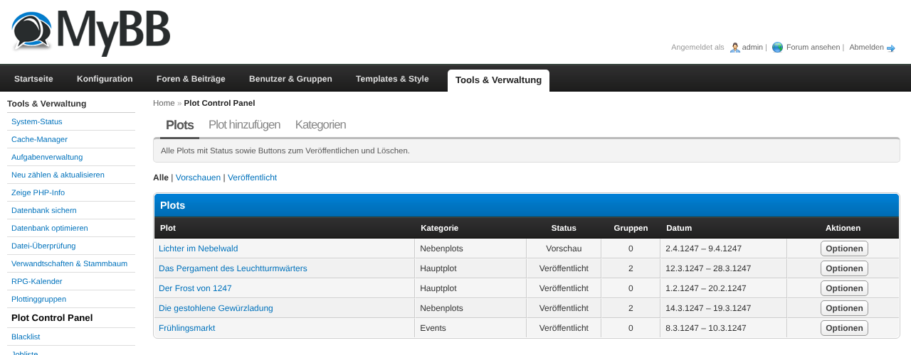
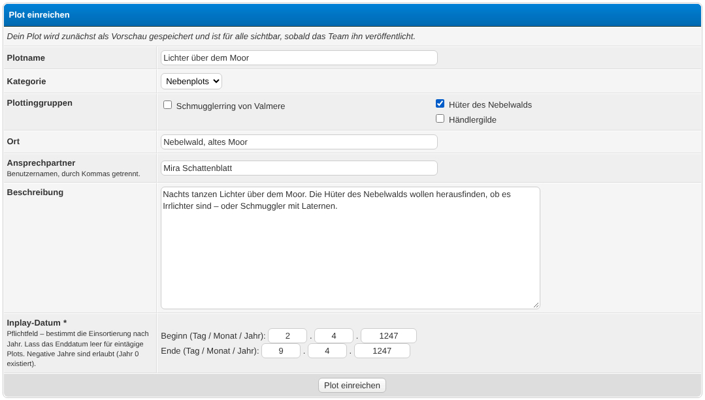
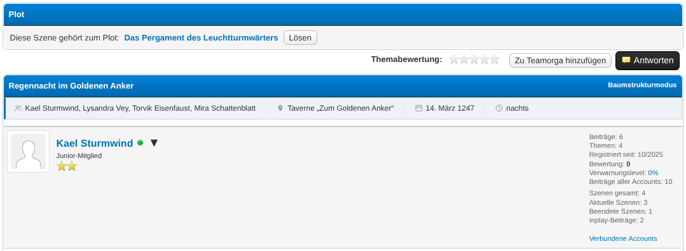

# Plot Control Panel (plotcp)

A MyBB 1.8 plugin for RPG forums that manages plots in one central place: plot
categories, plotting groups with self-service membership, a preview/publish
workflow with MyAlerts notifications, user submissions, scene linking for
inplay threads and automatic RPG Calendar integration.

## Features

- **Plot categories** (e.g. Plots, User plots, Mini plots, Info, Rumours,
  Blackboard) managed in the ACP; on the frontend each category is a tab, with
  a plot navigation on the left (grouped by inplay year, newest first) and the
  selected plot shown on the right
- **Plotting groups**: users join and leave groups themselves; every plot can
  be linked to any number of groups
- **Preview / publish workflow**: new plots start as previews that only
  configured groups (plus the team and the submitter) can see; publishing
  sends a MyAlerts notification to all members of the linked groups
- **User submissions**: users can submit plots (start as preview) and propose
  new plotting groups (require team approval; approval notifies all main
  accounts)
- **Scene linking**: in configured inplay/archive forums, the thread starter
  and the team can link a thread to a plot; the plot page lists all linked
  scenes
- **Archive**: plots can be marked as archived (shown with an "archived"
  badge); they stay listed in their category, there is no separate archive view
- **Optional IC date range** per plot with arbitrary years (negative years
  and year 0 included, proleptic Gregorian calendar) – dated plots appear
  automatically in the [RPG Calendar](https://github.com/pand0rica/rpgcalendar)
  month view via its provider hook

## Requirements

- MyBB 1.8.x
- PHP 7.4 or newer (tested up to PHP 8.1)
- **Optional:** [MyAlerts](https://community.mybb.com/mods.php?action=view&pid=avau1249) –
  without it the plugin works normally, just without notifications
- **Optional:** RPG Calendar (rpgcalendar) ≥ 1.0.0 – dated plots then appear
  in the calendar; without it nothing happens
- **Optional:** EnhancedAccountSwitcher – "new group" alerts then go to main
  accounts only instead of all accounts

No other dependencies.

## Installation

1. Upload all files to your MyBB root directory (the folder structure of the
   plugin matches the forum structure):
   - `plotcp.php` → forum root
   - `inc/plugins/plotcp.php` and `inc/plugins/plotcp/` → `inc/plugins/`
   - `admin/modules/tools/plotcp.php` → `admin/modules/tools/`
   - `inc/languages/...` → the matching language folders
2. Go to **ACP → Configuration → Plugins** and click **Activate** next to
   "Plot Control Panel".
3. Go to **ACP → Configuration → Settings → Plot Control Panel** and configure
   the plugin (see [Configuration](#configuration)).

## Configuration

| Setting | Meaning |
|---|---|
| **Preview visibility groups** | User groups that can see unpublished plots (previews). Team groups and the submitter of a plot always see it. |
| **Team groups** | Groups that may publish/archive plots, approve group proposals and manage scene links on any thread. They also receive submission alerts. |
| **Inplay forums** | Forums in which the plot link box is shown below threads. |
| **Archive forums** | Additional (archived) forums with the plot link box. |
| **Allow plot submissions** | Users may submit new plots via the frontend form. |
| **Allow group proposals** | Users may propose new plotting groups (team approval required). |

## Usage

### First steps after activation

1. **Create categories:** ACP → Tools & Maintenance → Plot Control Panel →
   tab **Categories** → enter name, description and order → **Save**. At
   least one category is required before plots can be created.
2. **Create plotting groups:** tab **Plotting groups** → enter name and
   description → **Save**. Groups created in the ACP are approved immediately
   (and announced via alert).
3. **Configure settings:** ACP → Configuration → Settings → Plot Control
   Panel → set team groups, preview groups and the inplay/archive forums.

### Managing plots (team)

- **Create:** ACP → Tools → Plot Control Panel → tab **Add plot**. Fill in
  name, category, plotting groups, location, contact persons (usernames,
  comma-separated), description (MyCode/BBCode **and** HTML supported) and the
  optional IC date range. The plot is saved as a **preview**.
- **Preview:** in the ACP plot list the plot title links to the rendered
  frontend page (opens in a new tab), and the options menu has a **View
  preview** entry – so you can check exactly how the plot will look, with all
  formatting, before publishing. Users who submit a plot are taken straight to
  its preview page after submitting.
- **Publish:** in the plot list open the options menu → **Publish** (or use
  the publish button on the plot's frontend page). All members of the linked
  plotting groups receive a MyAlerts notification.
- **Edit:** if you add another plotting group to an already published plot,
  only the members of the new group are notified – nobody gets a second alert.
- **Archive:** options menu → **Archive** marks the plot as archived. It keeps
  showing in its category on the frontend, just with an "archived" badge; it
  also stays visible in the RPG Calendar (it is history, after all).

### Plotting groups (users)

- Frontend page `plotcp.php` → **Plotting groups**: every approved group is
  listed with description and member count. **Join** and **Leave** are single
  clicks.
- **Propose a group:** the form below the list creates a proposal that waits
  for team approval (ACP → Plot Control Panel → Plotting groups → options →
  **Approve**). On approval every main account receives an alert (users can
  disable this in their alert settings).

### Submitting plots (users)

Frontend page `plotcp.php` → **Submit a plot**. The submitted plot starts as
a preview: the submitter and the preview groups can already read it, everyone
else sees it after the team publishes it. The team is notified about new
submissions.

### Linking scenes (inplay)

There are two ways to link a scene to a plot in the configured inplay/archive
forums:

- **When creating the thread:** the new-thread form shows a **Plot** dropdown
  (below the post icons). Pick a plot right away and it is linked as soon as
  the scene is posted.
- **In an existing thread:** the thread starter and the team see a **Plot**
  box below the first post. Select a plot and click **Link**, or **Unlink** to
  remove the connection.

A thread can belong to one plot at a time. Published plots are selectable for
everyone; the team can additionally pick preview plots.

Once a thread is linked, its plot appears in square brackets before the thread
title in the forum listing (`[Plot] Thread title`). Preview-plot names stay
hidden from users who may not see the preview.

### Alerts (MyAlerts)

Every user can control the plugin's notifications under
**User CP → Edit Alert Settings**:

- *A plot is published for one of my plotting groups*
- *A new plotting group is created*
- *A user submits a new plot or plotting group* (relevant for the team)

### RPG Calendar

No configuration needed. If the RPG Calendar plugin is installed, every
**published** plot with a date automatically appears in the month view as a
chip with the CSS class `rpgcalendar_event--plot` and as a row in the
important-events table. Previews are never delivered to the calendar.

### Tips

- **Date rules:** the inplay start date is required (it groups the plots by
  year in the navigation). Leave the end date empty for single-day plots.
  Negative years are fine (astronomical numbering, year 0 exists). February 29
  only exists in leap years – the form tells you if a date is invalid.
- **Deleting a category** is only possible while no plots use it.
- **Deleting a group** removes its memberships and plot links; the plots
  themselves stay.
- Members are collected at publish time: whoever leaves a group before the
  plot is published gets no alert.

## Uninstallation

1. ACP → Configuration → Plugins → **Deactivate** "Plot Control Panel"
   (removes templates, settings, stylesheet, alert types and the showthread
   template injection).
2. Click **Uninstall** to drop the six database tables. All plot data is
   deleted permanently.
3. Delete the uploaded files.

## Changelog

See [CHANGELOG.md](CHANGELOG.md).
